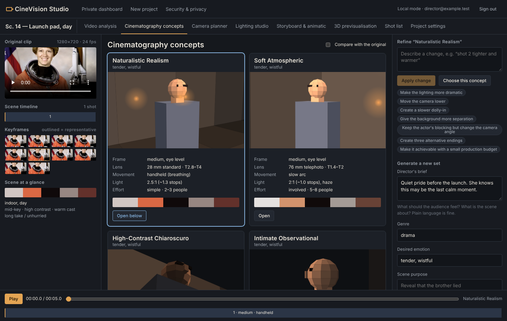

# CineVision Studio

A private AI director's assistant. Upload any video — a phone test, a short film, a full feature — and, without
filling anything in, get a **Director's review**: is it good, and what to change in camera, framing, lighting,
colour, sound, editing and titles, with the *why* behind each note, ways to edit it, and alternative ways to shoot
it shown as animated 3D animatics. Upload hundreds of clips with a story and **Movie assembly** puts them in story
order like an editor and sets aside the ones that don't fit. **Learn directing** turns the same reasoning into
lessons based on your own footage. Everything works in 16 languages, runs on your own machine, and can use a free
local AI (colibri, Ollama) for deeper notes. An **MCP server** lets AI assistants use CineVision as a tool.

Also included: camera planner, lighting studio, storyboard animatic, 3D proxy previs and exportable shot lists.

Everything runs on your own machine by default. Footage is encrypted at rest, never sent to third parties
without per-provider consent, and never used for training.



## Try it in your browser (no install)

**https://vjitintech.github.io/cinevision-studio/**

The browser edition runs entirely inside your browser tab: your clip is decoded and analysed on your device and
stored only in that browser (IndexedDB). The page's Content-Security-Policy (`connect-src 'none'`) stops it from
sending anything to any server. Use Chrome, Edge or Safari for MP4 (H.264); Firefox plays WebM most reliably.

Compared with the self-hosted edition it has no accounts or encryption at rest, doesn't detect people/faces, doesn't
measure camera tilt or lens perspective, and has no optional AI models. Everything else — concepts, refinement,
"your footage is good" verdict, camera planner, lighting studio, storyboard/animatic, 3D previs, shot list
(CSV/JSON/print-to-PDF) — works the same. It's rebuilt and republished by `.github/workflows/pages.yml` on every push.

## Install on Windows

**1. One-click app (recommended — nothing else to install).**
Download **CineVision-Windows-x64.zip** from the
[Releases page](https://github.com/vjitintech/cinevision-studio/releases), unzip it (right-click → *Extract All*),
open the folder and double-click **CineVision.cmd**. Your browser opens CineVision after a few seconds. Close the
CineVision window to stop it. Python, FFmpeg and the web interface are inside the zip; your projects and keys are kept
in `%LOCALAPPDATA%\CineVision` (copy its `keys` folder somewhere safe). Windows may warn that the download is not
signed: click *More info* → *Run anyway* only if it came from the Releases page.

**2. Source version, one line.** For people who want the latest code. In PowerShell:
```powershell
powershell -ExecutionPolicy Bypass -c "irm https://raw.githubusercontent.com/vjitintech/cinevision-studio/main/scripts/install_windows.ps1 | iex"
```
It installs Git, Python, Node.js and FFmpeg with winget if they're missing, downloads or updates CineVision in
`Documents\cinevision-studio`, adds a desktop shortcut and starts it. Run it again any time to update.

**3. Manual.** Install Python 3.13 (`winget install Python.Python.3.13`), Node.js (`winget install OpenJS.NodeJS.LTS`)
and FFmpeg (`winget install Gyan.FFmpeg`), open a new PowerShell window, then double-click `scripts\run_windows.cmd`
and open http://127.0.0.1:8000. More detail: [docs/INSTALL_WINDOWS.md](docs/INSTALL_WINDOWS.md).

CineVision only listens on this computer (127.0.0.1). On native Windows the FFmpeg sandbox has a timeout but no
memory/CPU limits — use Docker for footage you don't trust.

## Self-hosted edition — Docker

```bash
python3 scripts/gen_keys.py deploy/secrets             # master key + separate backup key (keep copies offline)
docker compose -f deploy/docker-compose.yml up -d --build
```
Open **https://localhost:8443**, trust Caddy's local certificate once, and create the owner account. On Windows,
run the same two commands in PowerShell from the repository folder (Docker Desktop).

Optional profiles: `--profile scan` (ClamAV) and `--profile llm` (Ollama); uncomment the matching variables in
`deploy/docker-compose.yml`.

### macOS / Linux without Docker
Needs Python 3.12+, Node 20+ and `ffmpeg` on your PATH.
```bash
./scripts/run_local.sh        # creates keys, venv, builds the UI, serves http://127.0.0.1:8000
```

## Free local AI (optional)

CineVision works without AI. For notes on story, performance and style, and an AI editor's order for movie
assembly, run a free model on your own computer and connect it under **AI & language**:

* **colibri** (github.com/JustVugg/colibri): run `START-HERE.bat`, then
  `py -3 c\coli start --port 8800 --background --no-browser` (CineVision uses port 8000).
* **Ollama**: `ollama pull qwen2.5vl:7b`, address `http://127.0.0.1:11434/v1`.

The page checks your RAM/GPU and recommends models. Frames only go to a server on this computer.

## AI assistants (MCP)

See [docs/MCP.md](docs/MCP.md) — six tools: review_video, get_review, list_projects, list_concepts,
refine_concept, assemble_movie.

## Configuration

| Variable | Default | Purpose |
|---|---|---|
| `CINEVISION_MASTER_KEY` / `_FILE` | **required** | 32-byte base64 key for encryption at rest |
| `CINEVISION_DATA_DIR` | `./data` | database + encrypted files |
| `CINEVISION_MODE` | `local` | `local` or `private-server` |
| `CINEVISION_PUBLIC_ORIGIN` | `https://localhost:8443` | origin allowed for state-changing requests |
| `CINEVISION_EXTRA_ORIGINS` | – | comma-separated additional allowed origins |
| `CINEVISION_COOKIE_SECURE` | `true` | set `false` only for plain-http on 127.0.0.1 |
| `CINEVISION_TRUST_PROXY` | `false` | honour `X-Forwarded-For` (only behind the bundled Caddy) |
| `CINEVISION_SIGNUP` | `open` | `open` (email + password, no email check), `owner_only` (first account, then invite codes from the owner or admins), `closed` (first account only) |
| `CINEVISION_ALLOW_REGISTRATION` | `true` | legacy: `false` means `CINEVISION_SIGNUP=owner_only` |
| `CINEVISION_HOST` / `_PORT` | `127.0.0.1` / `8000` | listen address; anything but loopback prints a warning at start-up |
| `CINEVISION_MAX_UPLOAD_MB` | `8192` | upload size cap |
| `CINEVISION_MAX_DURATION_S` | `14400` | video length cap (4 hours) |
| `CINEVISION_LOCAL_AI_URL`, `_MODEL`, `_VISION_MODEL` | – | preset for the local AI server (also settable in the app) |
| `CINEVISION_EMBEDDED_WORKER` | `false` | run the worker inside the API process (single-process setups) |
| `CINEVISION_FACE_MODEL` | – | YuNet ONNX file for face-based shot sizing |
| `CINEVISION_CLAMD_SOCKET` | – | ClamAV socket for malware scanning |
| `CINEVISION_OLLAMA_URL`, `_MODEL` | – | local LLM for free-text refinements |
| `CINEVISION_OLLAMA_VISION_MODEL` | – | free local vision model for AI scene notes (e.g. `qwen2.5vl:7b`) |
| `CINEVISION_EXTERNAL_LLM_URL`, `_MODEL`, `_KEY` | – | external LLM (also needs owner consent) |

## Using it
1. **New project** → name it and upload a video. That's all — the analysis, concepts and Director's review follow
   automatically. **Movie assembly** takes many clips plus an optional story. **Learn directing** has the lessons.
2. **Video analysis** → shots, camera movement, composition, light, colour, environment and mood. Solid outlines are
   measured, dashed are estimated, dotted are interpretations.
3. **Cinematography concepts** → generate 2–6 distinct approaches; compare with the original; refine in plain
   language ("make the lighting more dramatic", "shot 2 tighter", "small budget"); every change is a new revision.
   A banner tells you whether your footage is **already good** — if it matches one of the concepts closely and has no
   technical problems — and each concept shows how close it is to what you shot.
4. **Camera planner / Lighting studio / Storyboard & animatic / 3D previsualisation** → shape the chosen concept.
5. **Shot list** → snapshot and download as PDF, CSV or JSON.

## Documentation
* [Architecture](docs/ARCHITECTURE.md) · [Data model](docs/DATA_MODEL.md) · [API](docs/API.md)
* [Threat model](docs/THREAT_MODEL.md) · [Privacy & retention](docs/PRIVACY.md) · [Implementation plan](docs/IMPLEMENTATION_PLAN.md)
* **[What's implemented vs. needs configuration](docs/STATUS.md)**

## Backups
```bash
python3 scripts/backup.py create --data <data dir> --out backups --key-file deploy/secrets/backup_key
python3 scripts/backup.py restore --archive backups/<file>.cvbak --data <empty dir> --key-file deploy/secrets/backup_key
```
With Docker, the data lives in the `cinevision_cinevision-data` volume; stop the stack and mount it to back up.

## Tests
```bash
cd frontend && npm run build:pages && cd .. && python e2e/run_pages_e2e.py   # browser edition, checks no network calls
cd backend && pip install -r requirements-dev.txt && pytest -q     # 50+ integration tests against a real server
cd frontend && npm install && npm run build
python e2e/run_e2e.py --shots /tmp/shots                           # full flow in headless Chromium
```

## Acceptance criteria → evidence
| # | Criterion | Where it's verified |
|---|---|---|
| 1 | Secure registration & auth | `tests/test_auth.py` |
| 2 | Private project + valid upload | `test_upload_authz.py::test_upload_valid_clip_is_encrypted_at_rest` |
| 3 | Frames + genuine analysis | `test_pipeline.py` (known pan rate, zoom, static, cut) |
| 4 | Multiple distinct concepts | `test_concepts.py::test_generates_four_distinct_complete_concepts` |
| 5 | Camera, lens, lighting, composition, movement per concept | same test, required-field checks |
| 6 | Compare with original | Concepts "Compare with the original", Camera planner side-by-side (e2e) |
| 7 | Playable animatic + camera path | e2e asserts the animatic clock advances; 3D view shows paths |
| 8 | Controls update concept / preview | refinement & patch tests; camera/lighting save in e2e |
| 9 | Generate + export shot list | `test_exports.py`, e2e downloads |
| 10 | No cross-user access | `test_upload_authz.py::test_cross_user_access_is_404`, `test_concepts.py::test_concepts_isolated_between_users`, `test_exports.py::test_exports_are_private` |
| 11 | No external AI without consent | `test_llm_adapter.py`, `test_concepts.py::test_ai_preview_not_faked` |
| 12 | Deletion removes media, derived assets, jobs | `test_project_deletion_removes_everything`, e2e checks no encrypted files remain |
| 13 | Security tests | auth, CSRF/origin, headers, upload rejection, encryption, tamper detection |
| 14 | Unsupported AI clearly identified | `docs/STATUS.md`, adapter registry, `ai-preview` returns `not_configured` |
| 15 | Deployable with docs | this README, `deploy/`, `scripts/run_local.sh` |
