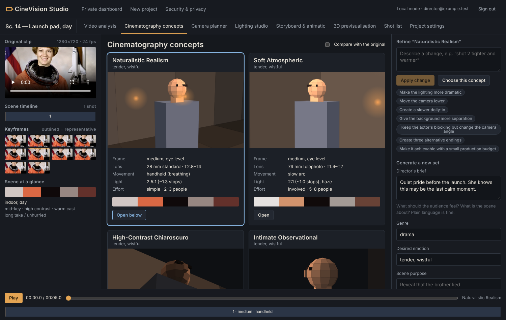

# CineVision Studio

A private previsualisation studio for directors and cinematographers. Upload a short clip of a scene and get
several genuinely different ways to shoot it — camera, lens, movement, blocking, lighting and grade — with a
camera planner, lighting studio, storyboard animatic, 3D proxy previs and an exportable shot list.

Everything runs on your own machine by default. Footage is encrypted at rest, never sent to third parties
without per-provider consent, and never used for training.



## Try it in your browser (no install)

**https://vjitintech.github.io/cinevision-studio/**

The browser edition runs entirely inside your browser tab: your clip is decoded and analysed on your device and
stored only in that browser (IndexedDB). The page's Content-Security-Policy (`connect-src 'none'`) stops it from
sending anything to any server. Use Chrome, Edge or Safari for MP4 (H.264); Firefox plays WebM most reliably.

Compared with the self-hosted edition it has no accounts or encryption at rest, doesn't detect people/faces, doesn't
measure camera tilt or lens perspective, and has no optional AI models. Everything else — concepts, refinement,
"your footage is good" verdict, camera planner, lighting studio, storyboard/animatic, 3D previs, shot list
(CSV/JSON/print-to-PDF) — works the same. It's rebuilt and republished by `.github/workflows/pages.yml` on every push.

## Self-hosted edition — quick start

### Docker (recommended)
```bash
python3 scripts/gen_keys.py deploy/secrets             # master key + separate backup key (keep copies offline)
docker compose -f deploy/docker-compose.yml up -d --build
```
Open **https://localhost:8443**, trust Caddy's local certificate once, and create the owner account. Registration
closes after the first account.

Optional profiles: `--profile scan` (ClamAV) and `--profile llm` (Ollama); uncomment the matching variables in
`deploy/docker-compose.yml`.

### Without Docker
Needs Python 3.12+, Node 20+ and `ffmpeg` on your PATH.
```bash
./scripts/run_local.sh        # creates keys, venv, builds the UI, serves http://127.0.0.1:8000
```

## Configuration

| Variable | Default | Purpose |
|---|---|---|
| `CINEVISION_MASTER_KEY` / `_FILE` | **required** | 32-byte base64 key for encryption at rest |
| `CINEVISION_DATA_DIR` | `./data` | database + encrypted files |
| `CINEVISION_MODE` | `local` | `local` or `private-server` |
| `CINEVISION_PUBLIC_ORIGIN` | `https://localhost:8443` | origin allowed for state-changing requests |
| `CINEVISION_EXTRA_ORIGINS` | – | comma-separated additional allowed origins |
| `CINEVISION_COOKIE_SECURE` | `true` | set `false` only for plain-http on 127.0.0.1 |
| `CINEVISION_TRUST_PROXY` | `false` | honour `X-Forwarded-For` (only behind the bundled Caddy) |
| `CINEVISION_ALLOW_REGISTRATION` | `false` | allow more accounts after the owner |
| `CINEVISION_MAX_UPLOAD_MB` | `500` | upload size cap |
| `CINEVISION_MAX_DURATION_S` | `300` | clip length cap |
| `CINEVISION_EMBEDDED_WORKER` | `false` | run the worker inside the API process (single-process setups) |
| `CINEVISION_FACE_MODEL` | – | YuNet ONNX file for face-based shot sizing |
| `CINEVISION_CLAMD_SOCKET` | – | ClamAV socket for malware scanning |
| `CINEVISION_OLLAMA_URL`, `_MODEL` | – | local LLM for free-text refinements |
| `CINEVISION_OLLAMA_VISION_MODEL` | – | free local vision model for AI scene notes (e.g. `qwen2.5vl:7b`) |
| `CINEVISION_EXTERNAL_LLM_URL`, `_MODEL`, `_KEY` | – | external LLM (also needs owner consent) |

## Using it
1. **New project** → name it, optionally set the director's brief, upload a clip.
2. **Video analysis** → shots, camera movement, composition, light, colour, environment and mood. Solid outlines are
   measured, dashed are estimated, dotted are interpretations.
3. **Cinematography concepts** → generate 2–6 distinct approaches; compare with the original; refine in plain
   language ("make the lighting more dramatic", "shot 2 tighter", "small budget"); every change is a new revision.
   A banner tells you whether your footage is **already good** — if it matches one of the concepts closely and has no
   technical problems — and each concept shows how close it is to what you shot.
4. **Camera planner / Lighting studio / Storyboard & animatic / 3D previsualisation** → shape the chosen concept.
5. **Shot list** → snapshot and download as PDF, CSV or JSON.

## Documentation
* [Architecture](docs/ARCHITECTURE.md) · [Data model](docs/DATA_MODEL.md) · [API](docs/API.md)
* [Threat model](docs/THREAT_MODEL.md) · [Privacy & retention](docs/PRIVACY.md) · [Implementation plan](docs/IMPLEMENTATION_PLAN.md)
* **[What's implemented vs. needs configuration](docs/STATUS.md)**

## Backups
```bash
python3 scripts/backup.py create --data <data dir> --out backups --key-file deploy/secrets/backup_key
python3 scripts/backup.py restore --archive backups/<file>.cvbak --data <empty dir> --key-file deploy/secrets/backup_key
```
With Docker, the data lives in the `cinevision_cinevision-data` volume; stop the stack and mount it to back up.

## Tests
```bash
cd frontend && npm run build:pages && cd .. && python e2e/run_pages_e2e.py   # browser edition, checks no network calls
cd backend && pip install -r requirements-dev.txt && pytest -q     # 50+ integration tests against a real server
cd frontend && npm install && npm run build
python e2e/run_e2e.py --shots /tmp/shots                           # full flow in headless Chromium
```

## Acceptance criteria → evidence
| # | Criterion | Where it's verified |
|---|---|---|
| 1 | Secure registration & auth | `tests/test_auth.py` |
| 2 | Private project + valid upload | `test_upload_authz.py::test_upload_valid_clip_is_encrypted_at_rest` |
| 3 | Frames + genuine analysis | `test_pipeline.py` (known pan rate, zoom, static, cut) |
| 4 | Multiple distinct concepts | `test_concepts.py::test_generates_four_distinct_complete_concepts` |
| 5 | Camera, lens, lighting, composition, movement per concept | same test, required-field checks |
| 6 | Compare with original | Concepts "Compare with the original", Camera planner side-by-side (e2e) |
| 7 | Playable animatic + camera path | e2e asserts the animatic clock advances; 3D view shows paths |
| 8 | Controls update concept / preview | refinement & patch tests; camera/lighting save in e2e |
| 9 | Generate + export shot list | `test_exports.py`, e2e downloads |
| 10 | No cross-user access | `test_upload_authz.py::test_cross_user_access_is_404`, `test_concepts.py::test_concepts_isolated_between_users`, `test_exports.py::test_exports_are_private` |
| 11 | No external AI without consent | `test_llm_adapter.py`, `test_concepts.py::test_ai_preview_not_faked` |
| 12 | Deletion removes media, derived assets, jobs | `test_project_deletion_removes_everything`, e2e checks no encrypted files remain |
| 13 | Security tests | auth, CSRF/origin, headers, upload rejection, encryption, tamper detection |
| 14 | Unsupported AI clearly identified | `docs/STATUS.md`, adapter registry, `ai-preview` returns `not_configured` |
| 15 | Deployable with docs | this README, `deploy/`, `scripts/run_local.sh` |
